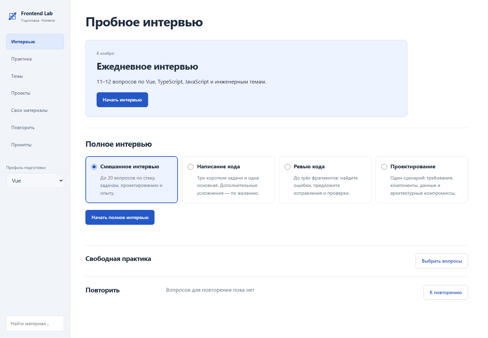
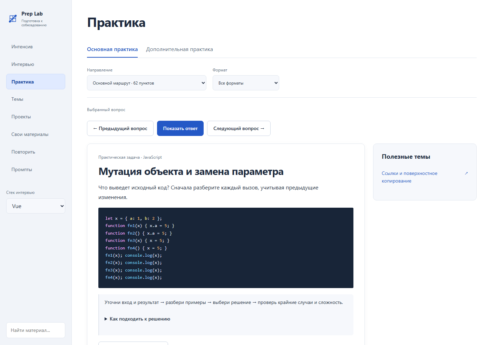
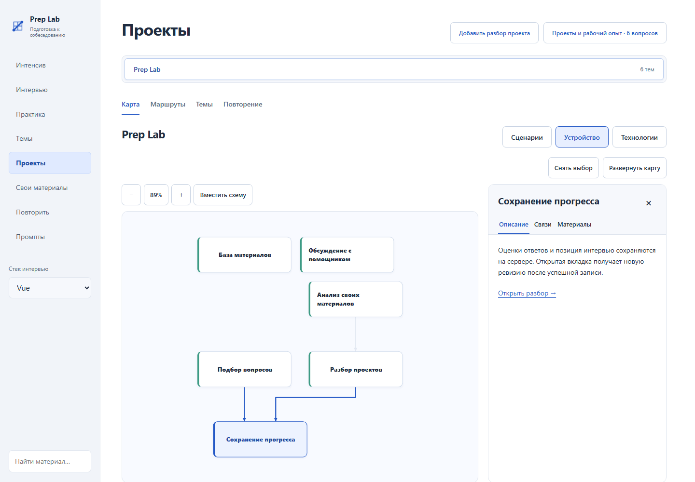
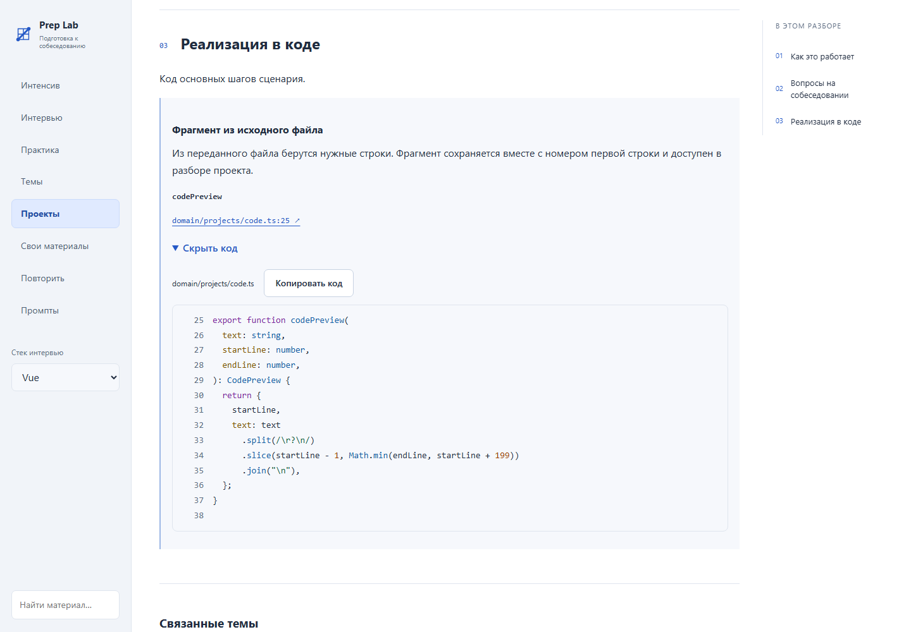

# Frontend Lab

Frontend Lab is an app for preparing for frontend interviews. Practice answering questions, work through unfamiliar topics, and revisit questions you found difficult.

The app runs in your browser and can be hosted on your computer or server. It includes a built-in question bank covering JavaScript, TypeScript, Vue, React, and software engineering topics. You can add your own notes and projects. Each instance is intended for a single owner.

## What you can do

- **Take mock interviews.** Choose a mixed interview or focus on coding, code review, or design. Answer one question at a time and review the explanation.
- **Practice by topic.** Choose questions and exercises for the Vue or React track.
- **Run hands-on exercises.** Explore request race conditions and React behavior in standalone projects with tests, or use the browser lab to investigate performance.
- **Revisit difficult questions.** Save questions you answered partially or couldn't answer to a review list.
- **Add your own materials.** Select a folder or upload materials, compare them with existing topics using the connected assistant, and choose which additions to keep. Import ready-to-use Markdown or Obsidian notes and ZIP archives, preview the changes, then choose what to accept.
- **Explore your projects.** Connect a repository and get an overview of its workflows, architecture, and technologies, with a visual project map and a source code viewer.
- **Discuss topics with the assistant.** Ask questions about the study materials, edit prompts, and generate drafts.

## Screenshots

### Interview formats



### Practice exercises



### Project map



### Source code viewer



## Quick start

You'll need Docker with Compose. Download the project, open a terminal in the project directory, and run:

```sh
docker compose up -d --build
```

Open **[http://127.0.0.1:4173](http://127.0.0.1:4173)**. The first build may take a few minutes.

To stop the app:

```sh
docker compose down
```

Materials, progress, discussions, and settings are stored in a local Docker volume. They are available the next time you start the app. Running `docker compose down -v` also deletes the volume.

To run without Docker, use a Node.js version supported by [package.json](package.json):

```sh
npm ci --ignore-scripts
npm run build
npm start
```

## Your first session

1. Choose the Vue or React track.
2. Start the daily interview, or open the practice section to work on a specific topic.
3. After your attempt, read the explanation and rate how confident you were in your answer.
4. Return to difficult questions in the review section.

You can read the study materials, take interviews, and review questions with or without the assistant. Connect it to discuss answers or get feedback tailored to your materials. You can review and edit the result before saving it to your knowledge base.

## Architecture and documentation

Frontend Lab uses Nuxt 4, Vue 3, TypeScript, Pinia, Nitro, and SQLite. The browser renders the interface. The server handles data, imports, and the assistant connection.

Use `npm run check` for development checks and `npm run check:all` to include browser tests. See the [documentation index](docs/README.md) for all guides.

- [User guide](docs/user-guide.md)
- [Adding your own materials](docs/sources.md)
- [Connecting the assistant](docs/assistant-connection.md)
- [Installation, updates, and running without Docker](docs/self-hosted.md)
- [Development and checks](docs/development.md)
