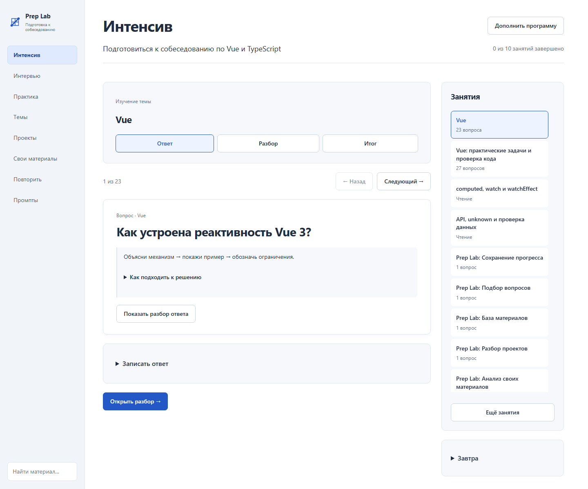

# Prep Lab

Prep Lab turns your projects and study materials into structured interview preparation. Explore how your projects work, practice explaining technical decisions, and build a study program around the topics you need.

Run it on your computer or server and use it in your browser. The built-in frontend collection covers JavaScript, TypeScript, Vue, React, and software engineering. Personal study programs can also use your own materials on backend development, analytics, or other subjects. Each instance has one owner and keeps their materials and progress together.

## What you can do

- **Build a focused study program.** Set a goal, select topics and projects, arrange the lessons, and work through the material and questions. Continue where you stopped and keep optional review separate from new topics.
- **Take frontend mock interviews.** Choose a mixed interview or focus on coding, code review, or design. Answer one question at a time and review the explanation.
- **Practice by topic.** Choose questions and exercises for the Vue or React track.
- **Run hands-on exercises.** Explore request race conditions and React behavior in standalone projects with tests, or use the browser lab to investigate performance.
- **Revisit difficult questions.** Save questions you answered partially or couldn't answer to a review list.
- **Add your own materials.** Select a folder or upload materials, compare them with existing topics using the connected assistant, and choose which additions to keep. Import ready-to-use Markdown or Obsidian notes and ZIP archives, preview the changes, then choose what to accept.
- **Explore your projects.** Connect a repository and get an overview of its workflows, architecture, and technologies, with a visual project map and a source code viewer.
- **Discuss topics with the assistant.** Ask questions about the study materials, edit prompts, and generate drafts.

## Screenshots

### Personal study program



### Interview formats


### Practice exercises


### Project map


### Source code viewer


## Quick start

You'll need Docker with Compose. Download the project, open a terminal in the project directory, and run:

```sh
docker compose up -d --build
```

Open **[http://127.0.0.1:4173](http://127.0.0.1:4173)**. The first build may take a few minutes.

To stop the app:

```sh
docker compose down
```

Materials, progress, discussions, and settings are stored in a local Docker volume. They are available the next time you start the app. Running `docker compose down -v` also deletes the volume.

To run without Docker, use a Node.js version supported by [package.json](package.json):

```sh
npm ci --ignore-scripts
npm run build
npm start
```

## Your first session

1. Open **Intensive**, describe your goal, and select the topics or projects you want to study.
2. Assemble the lessons, adjust their order, and accept your program.
3. Work through the material, answer questions, and save your progress.
4. Continue with the next lesson or revisit a topic separately.

For frontend mock interviews and topic practice, choose the Vue or React track in the sidebar. You can use these sections independently of your intensive.

The app assembles lessons from your selected materials locally. To arrange them with an AI assistant, copy the prepared prompt into your preferred assistant and paste its JSON response back into the app. Review the resulting order before accepting it.

Your accepted program keeps its goal. Add topics and updated materials as you go; completed lessons, saved answers, and results remain available.

You can read the study materials, take interviews, and review questions with or without the assistant. Connect it to discuss answers or get feedback tailored to your materials. You can review and edit the result before saving it to your knowledge base.

## Architecture and documentation

Prep Lab uses Nuxt 4, Vue 3, TypeScript, Pinia, Nitro, and SQLite. The browser renders the interface. The server handles data, imports, and the assistant connection.

Use `npm run check` for development checks and `npm run check:all` to include browser tests. See the [documentation index](docs/README.md) for all guides.

- [User guide](docs/user-guide.md)
- [Adding your own materials](docs/sources.md)
- [Connecting the assistant](docs/assistant-connection.md)
- [Installation, updates, and running without Docker](docs/self-hosted.md)
- [Development and checks](docs/development.md)
