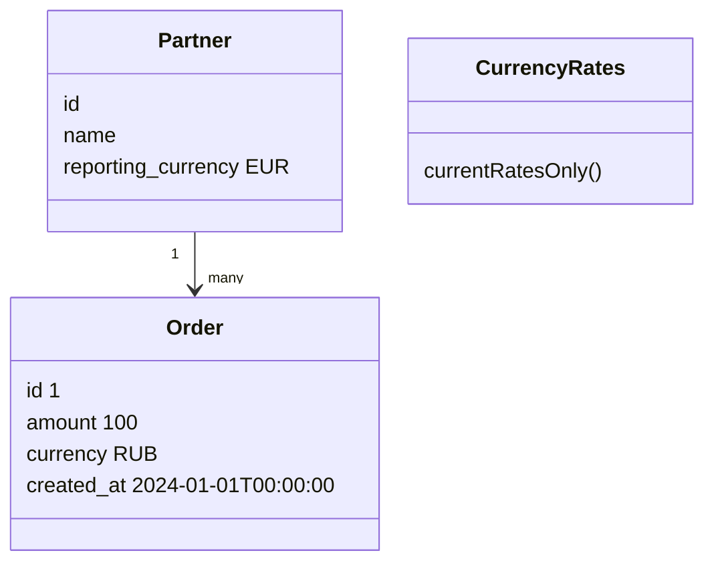

# Проектирование систем: задачи

[[Собеседования/00. Карта раздела|Карта банка]]

Дополнительные задачи на контракт API, неопределённость и взаимодействие с backend. Полный серверный дизайн не обязателен для Vue/TypeScript-роли. Сначала проходи frontend-кейсы; эти выбирай при отдельном сигнале от вакансии или интервью.

Сначала предложите решение самостоятельно. Затем откройте разбор, если он есть. Отделяйте данные условия от допущений; недостающие условия уточняйте до вывода.

> [!abstract]- Вопросы и задачи на этой странице
>
> - [[Собеседования/Проектирование/Системы и API#API оплаты и статусы|API оплаты и статусы]]
> - [[Собеседования/Проектирование/Системы и API#Синхронизация бронирований между OTA и CRM|Синхронизация бронирований между OTA и CRM]]
> - [[Собеседования/Проектирование/Системы и API#Отчёты партнёров в разных валютах|Отчёты партнёров в разных валютах]]
> - [[Собеседования/Проектирование/Системы и API#Условие|Условие]]
> - [[Собеседования/Проектирование/Системы и API#Дополнительные условия|Дополнительные условия]]
> - [[Собеседования/Проектирование/Системы и API#Распределённая блокировка документов|Распределённая блокировка документов]]
> - [[Собеседования/Проектирование/Системы и API#Дубли заказов доставки|Дубли заказов доставки]]
>

## API оплаты и статусы

На странице есть итоговая цена и форма оплаты. Спроектируйте взаимодействие клиента, сервера и платёжного провайдера для списания денег. Определите создание операции, подтверждение, статус, дополнительную аутентификацию, возврат пользователя и ошибки.

**Уточнения из условия:** кто считает цену; какие поля и границы валидируются; что будет при повторном запросе; как использовать ключ безопасного повторения операции; что делать после перезагрузки; как подтвердить результат, если обработчик потерян. Не сводите успешную оплату к редиректу в браузере.

> [!example]- Проверка решения
>
> Цена и доступ к заказу проверяются сервером. Состояние операции хранится устойчиво; возврат пользователя в браузер и webhook провайдера могут приходить в разном порядке. Не переносите исходное ограничение «все карты 16 цифр» в универсальный API. Способ ввода/токенизации и валидацию согласуйте с провайдером. Для примера жизненный цикл/состояние/idempotency см. [Stripe Payment Intents](https://docs.stripe.com/payments/payment-intents); для обработки карточных данных — [безопасность интеграции](https://docs.stripe.com/security/guide). Это материал для проектирования, не реализация платежей.
>

## Синхронизация бронирований между OTA и CRM

Клиент бронирует, меняет дату и отменяет бронь в OTA. Сотрудник делает это в CRM от имени клиента и меняет статус обработки. В первой версии 10 000 бронирований в месяц; два интерфейса читают данные разных сервисов. Объясни базовый сценарий и границу ответственности, не проектируя датацентры.

Сначала уточни, кто владеет датами, статусом и доступом; допускается ли задержка отображения; какие переходы обратимы. Предложи API, идентичность брони, версии и отображение результата, пока системы расходятся. Что покажет клиент после таймаута отмены или одновременного изменения дат сотрудником? Как восстановить статус без повторной опасной операции?

Обсуди контракт повторов и уведомлений с backend, интеграционные тесты двух интерфейсов, диагностику по operation ID и допустимую деградацию. Не раскрывай персональные данные в журнале. Следующий шаг: появился новый тип бронирования — какие границы выдержат изменение?

> [!example]- Проверка решения
>
> У каждого поля есть владелец, конфликт и задержка синхронизации имеют явное поведение. Повтор связан с идентичностью операции, интерфейс различает ожидание и подтверждённый результат. Нужны проверка прав, тест потерянного ответа и наблюдаемость согласования. Очередь сама по себе не гарантирует согласованность.

## Отчёты партнёров в разных валютах

### Условие

Мы B2B сервис бронирования гостиниц и разрабатываем систему, в которой партнеры могут делать отчёты по совершённым бронированиям. Предположим есть сущность `Order`, у которой есть несколько параметров: `id`, `amount: 100`, `currency: RUB`, `created_at: 2024-01-01T00:00:00`. И есть сущность `Partner`, у которой есть параметры: `id`, `name: "ООО Ромашка"`, `reporting_currency: EUR`. У `Partner` может быть много `Order`. Курс валюты заказа фиксируется на момент его создания.

Также рядом есть сервис курсов валют, который может отдавать курс только на текущую дату и не может отдавать курсы из прошлого (и тем более из будущего).

Партнёр хочет иметь возможность скачивать отчет по заказам в своей валюте, то есть в евро. Сейчас у партнёра есть заказ в рублях. Сейчас это сделать невозможно, так как мы не можем рассчитать стоимость заказа в евро. Как спроектировать систему в которой это возможно?

### Дополнительные условия

Сущности:



Надпись «Hotel booking for 1 EUR» в макете отчёта — иллюстрация формата, а не заданный курс RUB/EUR. Его нельзя вычислить из предоставленных данных. После изменения reporting_currency прошлые заказы должны остаться пересчитываемыми.

## Распределённая блокировка документов

Вы разрабатываете сервис, в котором юристы работают с документами. Есть база данных с большим количеством документов и веб-интерфейс, с помощью которого юристы вносят правки в документы.

Метод для подгрузки документа в веб-интерфейс:

```text
public byte[] read(int docID) {
    return db.loadDoc(docID).getContent();
}
```

Метод для сохранения документа:

```text
public void update(int docID, byte[] content) {
     Doc doc = db.loadDoc(docID);
     doc.setContent(content);
     db.updateDoc(docID, content);
}
```

Т.к. несколько юристов могут одновременно начать работать над одним документом, то результаты редактирования могут быть сохранены неправильно (в БД окажется версия, сохраненная последней). Для защиты от такой ситуации необходимо организовать блокировку документа на время редактирования, чтобы только один юрист мог вносить правки в один момент времени.

Опишите, как бы вы реализовали работу с блокировками?

> [!example]- Исходный вариант для разбора — не готовое решение
>
> Рассмотрим ZooKeeper или etcd и временное право удержания блокировки. Если право получить не удалось, документ открывают только для чтения. Но проверка блокировки отдельно от записи имеет гонку: право может истечь между проверкой и сохранением.
>
> Защита от устаревшего владельца требует участия самого хранилища: оно должно атомарно отклонять запись с устаревшим маркером владения. Такой маркер называют fencing token. Одной успешной проверки внешней блокировки недостаточно. Обсудите выдачу маркера, смену владельца, потерю связи и истечение срока.
>
> Найди ошибку в псевдокоде; запись здесь не защищена атомарной проверкой:
>
> ```text
> DistributedLockService locks = ...;
>
> public WebDoc read(int docID) {
>     Lock lock = locks.tryLock(docID, minutes(10));
>     Doc doc = db.loadDoc(docID);
>
>     // if lock failed, doc is read only
>
>     return new WebDoc(doc, lock, readonly=lock.isFailed);
> }
>
> // periodically call from client, if user still works with doc
> public void ping(WebDoc doc) {
>      locks.tryRenew(doc.id, doc.lock);
> }
>
> public void update(WebDoc doc) {
>      boolean ok = locks.checkLock(doc.id, doc.lock, minutes(10));
>
>      if (!ok) {
>         throw new LockExpiredException(doc);
>      }
>
>      db.updateDoc(doc.id, doc.content);
>
>      locks.release(doc.lock)
> }
> ```
>

## Дубли заказов доставки

При тестировании приложения доставки продуктов регулярно создаются дубли заказов. Опишите возможные источники: повторное нажатие или запрос, несколько узлов, повторная доставка сообщения и одновременные фоновые исполнители. Предложите ключ безопасного повторения операции, атомарное сохранение результата и проверку содержимого сообщения; обсудите состояние «операция выполнена, ответ потерян», срок хранения ключа и ограничения уникального индекса. Одной блокировки кнопки на клиенте недостаточно.
